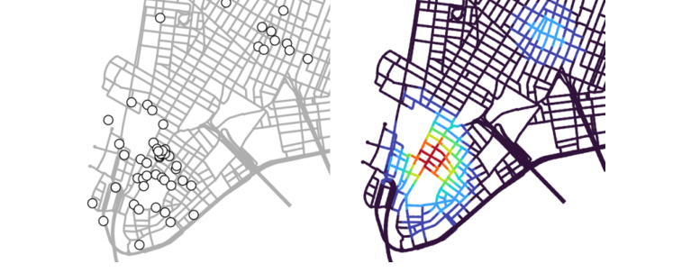
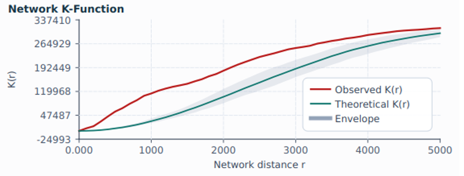
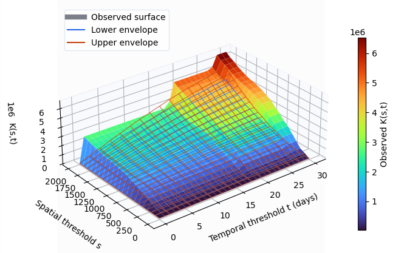
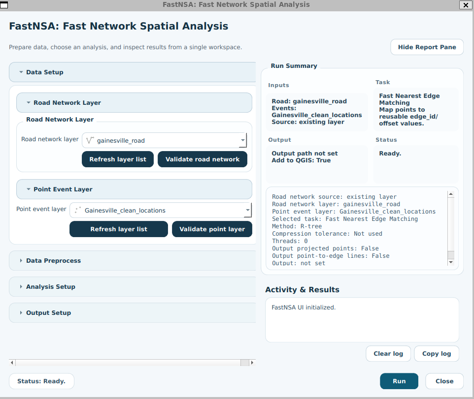
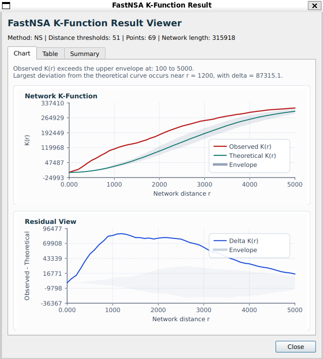
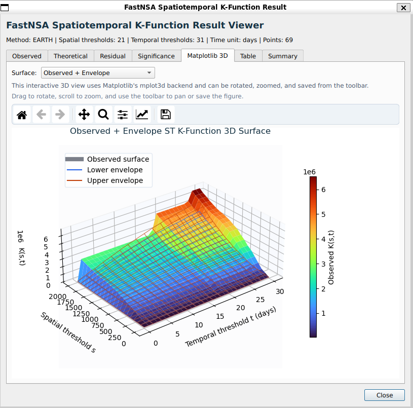

  

# FastNSA for QGIS

**Explore spatial patterns along road networks, directly in QGIS.**

FastNSA brings event matching, network density mapping, and spatial and
spatiotemporal K-function analysis into one GIS workspace. Prepare your data,
run an analysis, and explore maps, curves, and surfaces without writing code
or moving between applications.

It is designed for GIS users and researchers studying traffic incidents,
public-safety records, urban activity, and other events associated with road
networks.

[Download](https://github.com/fastnsa/FastNSA-QGIS/releases) |
[Quick Start](qgis/docs/quickstart.md) |
[User Guide](qgis/docs/index.md) |
[Chinese Overview](qgis/README_ZH.md)

*From event locations to density hotspots along the network.*

## What Can You Analyze?

Unlike straight-line analysis, network-based methods account for distances
along the road network. FastNSA helps answer questions about both where
events concentrate and how they interact across spatial and temporal scales.

| Workflow | Research question | Results |
| --- | --- | --- |
| **Nearest-edge matching** | Where does each event lie on the network? | Matched events that can be reused in subsequent analyses; optional projected points and connector lines. |
| **Network density (NKDV)** | Where are events concentrated along roads? | Styled density-valued line segments, computed with **ADA** or **LION**. |
| **Network K-function** | At which network-distance scales do events exhibit clustering or dispersion relative to a simulated reference? | Observed and reference curves, Monte Carlo envelopes, and result tables; **NS** and **STARS** methods. |
| **Spatiotemporal network K-function** | How does event interaction vary across network distance and time? | Spatial-temporal result surfaces, envelopes, and tables, with **EARTH** and alternative methods. |

## Explore the Results

| Network K-function | Spatiotemporal network K-function |
| --- | --- |
|  |  |
| Compare event interaction with a simulated reference across network distances. | Explore spatial and temporal thresholds together, with optional interactive 3D views. |

Use the **FastNSA workspace** to configure analyses and inspect interactive
results, or the **Processing Toolbox** to incorporate the same workflows into
QGIS models and batch processing. Density results become styled map layers;
K-function results can be explored as charts, surfaces, and tables in the
workspace.

<strong>View the workspace and result viewers</strong>

### Analysis Workspace

Choose your road network and event layers, prepare reusable event mappings,
and configure an analysis from one window.

### Result Viewers

| Network K-function viewer | Spatiotemporal result viewer |
| --- | --- |
|  |  |

## Install

Download the **plugin ZIP for your platform** from
[GitHub Releases](https://github.com/fastnsa/FastNSA-QGIS/releases).

| Platform | Version 0.1.0 package |
| --- | --- |
| Linux x86_64 | `fastnsa_qgis-0.1.0-linux-x86_64.zip` |
| Windows AMD64 | `fastnsa_qgis-0.1.0-windows-amd64.zip` |

1. In QGIS, open **Plugins > Manage and Install Plugins > Install from ZIP**.
2. Select the downloaded plugin ZIP and enable **FastNSA**.
3. Open FastNSA from its toolbar button or plugin menu. The four workflows
   are also listed under **Processing Toolbox > FastNSA**.

Use the platform-specific plugin ZIP, not GitHub's **Source code** archive.
The package includes FastNSA 0.3.0; no separate FastNSA installation is needed.

**Source-only installations:** These need `fastnsa==0.3.0` installed separately.
Open **FastNSA > Runtime setup** for guidance, or follow the
[FastNSA setup guide](qgis/docs/external-runtime.md). The platform-specific
GitHub packages described above already include the runtime.

**Requirements:** QGIS 3.34 through QGIS 3.x with Qt5, Python 3.11 or newer,
NumPy, and a compatible system C++ runtime. Matplotlib is optional and enables
interactive 3D surfaces. macOS plugin packages and QGIS 4/Qt6 are not supported
in this release. See the [installation guide](qgis/docs/installation.md) for
details.

## Your First Analysis

1. **Load your data.** Add a road line layer in a projected CRS and a point
   layer containing the events you want to study.
2. **Prepare the events.** Run **Fast Nearest Edge Matching** and inspect the
   projected points or connector lines if needed.
3. **Choose an analysis.** Use the matched events with the same road network
   for network density, network K-function, or spatiotemporal K-function.
4. **Explore and save.** Inspect map layers and result viewers, then save
   spatial outputs to GeoPackage or export statistical tables to CSV.

For spatiotemporal analysis, select an event time field and the appropriate
time unit. The [time-field guide](qgis/docs/time-fields.md) explains the options.
For a guided walkthrough, follow the [Quick Start](qgis/docs/quickstart.md).

Prefer a scripting workflow? The underlying
[FastNSA Python package](https://github.com/fastnsa/FastNSA) provides access to
the native analysis engine outside QGIS.

## Documentation

| Guide | What you will find |
| --- | --- |
| [User Guide](qgis/docs/index.md) | Overview and navigation for the full manual. |
| [Quick Start](qgis/docs/quickstart.md) | A first analysis from input layers to saved results. |
| [Analysis Workflows](qgis/docs/workflows.md) | Parameters and method choices for all four workflows. |
| [Time Fields](qgis/docs/time-fields.md) | Date/time fields, numeric timestamps, and analysis units. |
| [Outputs and Interpretation](qgis/docs/outputs-and-interpretation.md) | Map layers, density styles, K-function curves, and envelopes. |
| [Troubleshooting](qgis/docs/troubleshooting.md) | Help with installation, input data, and common errors. |

## Support and License

Questions, bug reports, and feature requests are welcome in
[GitHub Issues](https://github.com/fastnsa/FastNSA-QGIS/issues). For bug reports,
please include your QGIS and plugin versions, analysis parameters, and relevant
error messages.

The software is licensed under [LGPL-2.1-only](LICENSE).
